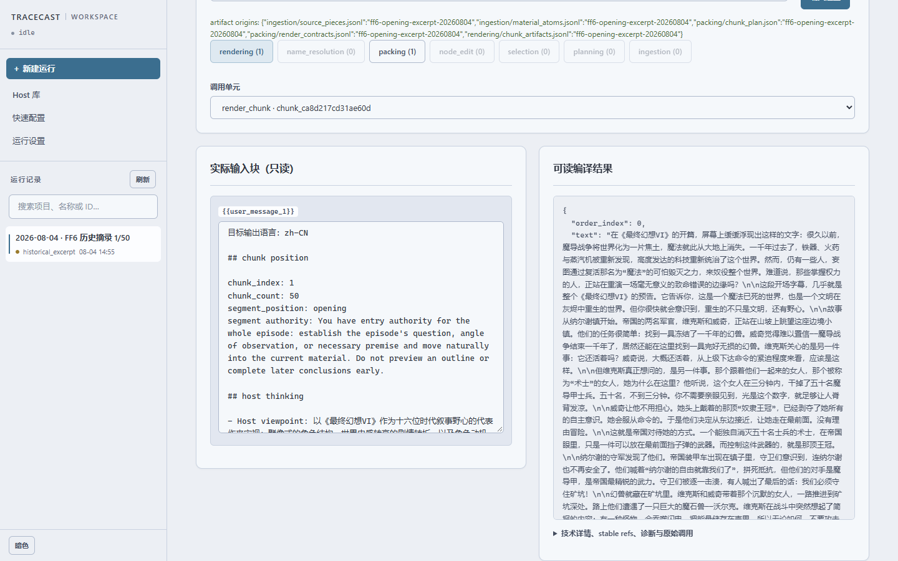

# Tracecast

将本地长篇材料改写为指定主持人风格的长播客脚本，用于听力练习；每个生成分段可回查原始材料与模型调用。

**已停止开发，复盘公开。** 生成流程与本地 Console 已实现，但长稿的整体组织和叙述一致性仍未达到预期。
仓库保留源码、测试、使用文档与可浏览的真实历史案例。

[快速体验](#快速体验无需-api-key) · [案例与截图](docs/user/console-case.md)
· [生成自己的脚本](docs/user/getting-started.md)
· [公开复盘](https://blog.anemoyas.homes/posts/tracecast-retrospective)

## 项目目标

起点是个人听力练习：把感兴趣的长篇材料改写成愿意持续听下去的播客稿，同时控制输出语言、
讲述者的选材偏好与表达方式，并在发现内容问题时回查当时使用的材料和模型输入。

Tracecast 接收文本材料与独立的主持人配置（Host），输出可编辑脚本和分阶段运行记录。
Console 提供材料与 Host 管理、运行追踪和局部重新生成的操作界面。目前不生成音频；
网页、PDF 的获取与清洗由外部工具完成。

## 真实案例

下图来自 Console 的阶段追踪：左侧是保存的历史输入，右侧是包含中文正文的分段记录。
案例选自 **2026-08-04 一次 FF6 历史运行的第 1/50 段**，包括 1,572 字符的原正文、
10 条材料、13 个来源切片，以及一次模型调用的实际请求和响应。



正文与请求没有为展示重新生成。这个案例用于检查输入、材料与调用的对应关系，不包含整稿，
也不用于证明整体写作质量或压缩效果。历史 prompt 与当前模板存在版本差异，查看时以保存的原始请求为准。

[从首页选择案例、查看材料与实际调用](docs/user/console-case.md)

## 快速体验：无需 API key

需要 **Python 3.12 或更高版本**。项目从源码安装；克隆本仓库后，在仓库根目录执行。
以下命令安装 Console 并准备历史案例，不调用模型。依赖安装需要可用的软件包来源。

PowerShell：

```powershell
python -m venv .venv
.\.venv\Scripts\python.exe -m pip install ".[console]"
.\.venv\Scripts\python.exe tools/prepare_console_case.py --output tmp/console-case --port 8770
```

Bash/zsh：

```bash
python3 -m venv .venv
./.venv/bin/python -m pip install '.[console]'
./.venv/bin/python tools/prepare_console_case.py --output tmp/console-case --port 8770
```

准备脚本校验并复制案例，随后打印 Console 启动命令。**复制并执行这条启动命令**，再打开
`http://127.0.0.1:8770/`：

1. 在左侧运行记录中选择 **2026-08-04 · FF6 历史摘录 1/50**。
2. 点击 **诊断**，选择第 1 段并点击 **载入追查**。
3. 在 **rendering** 查看历史输入与正文，在 **packing → materials** 查看对应材料。
4. 打开 **模型调用**，点击调用行查看保存的 request 和 response。

完整操作截图见[案例指南](docs/user/console-case.md)。首页“没有可用项目”和结果页没有整稿，
均是这份历史摘录的预期状态。浏览案例不需要填写 API 配置。

准备脚本拒绝覆盖已有目录；再次准备时换一个 `--output` 路径。端口被占用时可更换 `--port`，
并使用脚本打印的新地址。按 `Ctrl+C` 停止 Console。案例和准备工具随源码仓库提供，不进入 Python 发行包。

## 工作流程

```text
文本材料 → 切片与材料整理 → 候选内容与选序 → 保留／压缩／省略 → 分段生成 → 拼接脚本
                                  ↑                           ↑
                             Host 选材偏好                Host 表达配置
```

每次运行保存各阶段的结构化产物、报告和模型调用记录。

| 能力 | 实际行为 |
|---|---|
| 材料与表达配置分开管理 | 项目保存来源材料；Host 保存选材、表达偏好与示例。Host Builder 可从偏好成稿构建可复用 Host，风格示例不作为项目事实材料。 |
| 内容取舍有记录 | 保存候选内容的选择顺序，以及材料的保留、压缩或省略记录；压缩材料保留来源引用。 |
| 生成过程可追查 | 从生成分段查看材料、实际模型请求与响应，以及调用和版本记录。 |
| 局部调整保留原结果 | 为选序、材料编辑、正文生成或单个分段创建派生运行，复用上游产物并另存结果。 |

追溯以分段、材料和调用为单位，不提供逐句事实验证；保存历史请求也不保证再次调用模型得到相同结果。

## 使用自己的材料生成脚本

使用虚拟环境的 Python 执行 `-m tracecast console`，在默认地址 `http://127.0.0.1:8766/`
配置 OpenAI-compatible Chat Completions gateway、API key 和模型名，再导入文本、选择 Host、
检查估算并确认运行。生成会产生多次模型调用及相应费用；`projects/example/` 可用于连接验证。

Console 默认只监听本机回环地址，没有用户认证，不应暴露到局域网或公网。
安装、启动命令、CLI 用法与输出文件说明见[安装与首次运行](docs/user/getting-started.md)；
其他选项见
[配置参考](docs/user/configuration.md)和[隐私、成本与安全](docs/user/privacy-cost-safety.md)。

## 开发与测试

源码入口：[主链编排](src/tracecast/pipeline.py)、[跨阶段数据结构](src/tracecast/domain/)、
[Console 调用追踪](src/tracecast/console/stage_trace.py)。
模型输出由程序解析、校验和包装，稳定 ID、hash 与持久化由代码负责。

在已创建虚拟环境的源码仓库中，可以无 API key 运行主链测试：

PowerShell：

```powershell
.\.venv\Scripts\python.exe -m pip install ".[dev,console]"
.\.venv\Scripts\python.exe -m pytest tests/test_pipeline_e2e.py -q
```

Bash/zsh：

```bash
./.venv/bin/python -m pip install '.[dev,console]'
./.venv/bin/python -m pytest tests/test_pipeline_e2e.py -q
```

[端到端测试](tests/test_pipeline_e2e.py)向正式流水线注入 fake `call`，检查阶段交接、产物和失败行为，
不调用模型，也不评价写作质量。完整检查使用同一虚拟环境的 Python 执行
[tools/verify.py](tools/verify.py)；公开文件与发行包检查入口为
[tools/check_publication.py](tools/check_publication.py)。

## 开发方式

这是一个借助 coding agent 开发的个人项目。作者主导需求、材料与风格偏好、方案取舍和成稿审读；
代码与测试借助 coding agent 实现和迭代。

## 许可

项目代码使用 [Apache License 2.0](LICENSE)。
历史案例引用的原文与游戏内容权利归相应权利人，来源和摘录范围见[案例说明](examples/console-case/README.md)。
