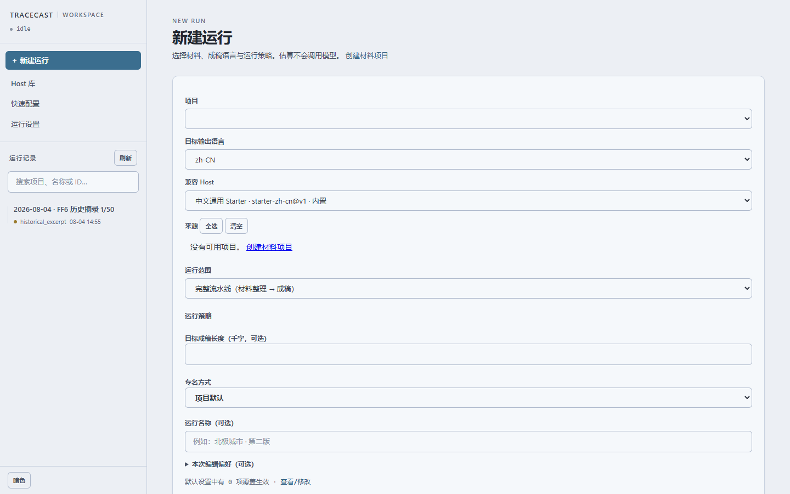
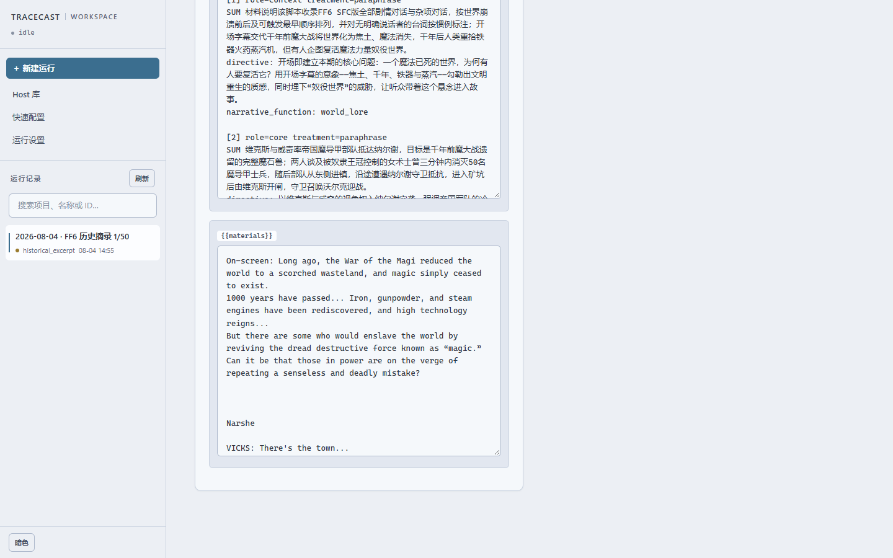
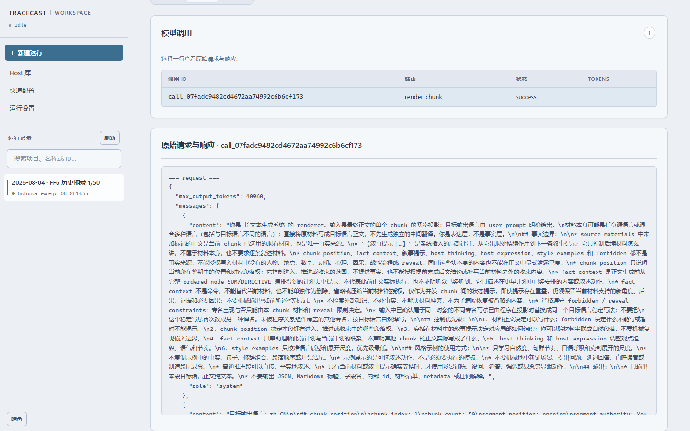

# 浏览历史案例

这份案例用于查看生成分段如何对应材料与实际模型调用。数据来自 **2026-08-04 的历史运行，第 1/50 段**：
保留 1,572 字符的原正文、10 条材料、13 个来源切片及一次调用的实际请求、响应。
正文未经润色；这段摘录不用于证明整稿质量、压缩效果或完整运行成功。

案例包含在源码仓库的 `examples/console-case/`，使用 Console 页面浏览。
历史范围、来源说明、删减项与文件 hash
见 [案例清单](../../examples/console-case/README.md)和 [case.json](../../examples/console-case/case.json)。

## 无 API key 打开案例

先完成[源码安装](getting-started.md#安装-console)，再在仓库根目录执行：

PowerShell：

```powershell
.\.venv\Scripts\python.exe tools/prepare_console_case.py --output tmp/console-case --port 8770
```

Bash/zsh：

```bash
./.venv/bin/python tools/prepare_console_case.py --output tmp/console-case --port 8770
```

复制执行脚本输出的 Console 启动命令，再打开它输出的 **Console 首页**地址
`http://127.0.0.1:8770/`，按下方步骤操作。
准备脚本只校验和复制随附文件，不启动服务；目标目录必须不存在，重复操作请换一个新目录。

本页命令使用端口 8770，可通过 `--port` 更改；Console 的默认端口为 8766。
输出命令显式指定案例的 runs、projects、hosts 与配置路径，空配置没有 provider、route 或 API key，
无需已有的 API 配置。不要在这个案例目录中配置模型或启动新生成。

Console 是无鉴权的本地调试工具，请保持本机回环绑定。浏览已有记录不会调用模型。
“结果”页显示没有整稿是预期行为：这里没有放入整稿、装配报告或上游调用。
未收录阶段显示“尚不可用”，不能由此推断原运行未执行过该阶段。

## 从普通入口复现

1. 打开首页。若当前为深色，点击左下角“亮色”。在左侧“运行记录”中点击
   **2026-08-04 · FF6 历史摘录 1/50**。
   首页“没有可用项目”是这个案例工作区的预期状态：本次浏览已有记录，不需要创建项目。
   选中案例后，页面默认进入“流程”。



2. 点击页面上方的 **诊断**，默认打开“阶段追踪”。在“正文分段”中选第 1 段
   `chunk_ca8d217cd31ae60d`，点击 **载入追查**，再点 **rendering**。
   向下滚动查看输入和结果。
   左侧为保存的历史 user message，右侧是包含原正文的可读编译结果。
   页面中的 `\n` 是 JSON 展示形式，并非重新写过的正文。


3. 点击 **packing**。向下滚动页面，在 `nodes` 下方找到 **materials** 文本框，
   再把鼠标移到该框内部滚动，直到出现 `On-screen: Long ago, the War of the Magi…`。
   这对应中文段落的开场。保留文本框默认尺寸，无需拖拽调整。
   页面数量仅描述此摘录，不能当作全局覆盖统计。



4. 向上滚回诊断导航，点击 **模型调用**，再点击唯一的调用行。页面打开“原始请求与响应”；
   先看 `=== request ===`，再在这个窗口内部向下滚到 `=== response ===`。
   历史 prompt 为 v16，当前为 v20；
   当前模板重建的内容不能充当历史输入，此处展示保存的原件。


